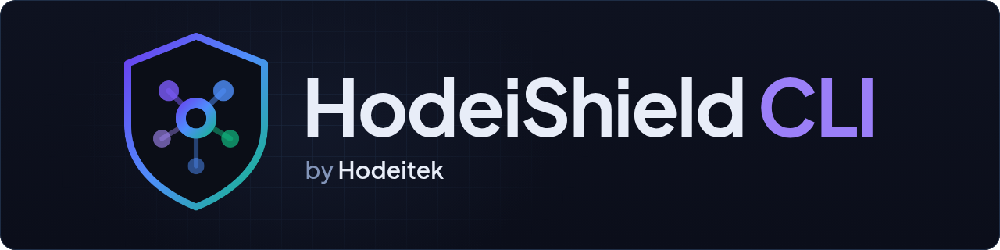

# HodeiShield CLI

<!-- security-notice:start -->
<!-- security-notice:end -->

[](https://github.com/Hodeitek/hodeishield-cli/releases/latest)
[](https://github.com/Hodeitek/hodeishield-cli/actions/workflows/ci.yml?query=branch%3Amain)
[](LICENSE)
[](docs/verifying-releases.md)

The official command-line client for [HodeiShield](https://hodeishield.com), by
[Hodeitek](https://hodeitek.com). HodeiShield covers third-party risk, supply-chain security and
compliance (NIS2, DORA, ISO 27001, ENS).

Security policy, how to report a vulnerability and where advisories appear: [SECURITY.md](SECURITY.md).

## Quick start

```sh
# Download and unpack the archive for your platform from
# https://github.com/Hodeitek/hodeishield-cli/releases/latest, then:
hodeishield login            # sign in through the browser and pick a tenant
hodeishield vendors list     # your third-party inventory
```

Verify the download before you run it: see [Install](#install) and [Verify a download](#verify-a-download).

Read your third-party inventory, supply-chain alerts, risk register, compliance posture, evidence and
endpoint agents from a terminal or a script.

- **Read-only.** Every command is a `GET` against the public `/v1` API. Nothing here can change data in
  your organisation.
- **Safe with credentials.** Sign-in tokens live in the system keychain, never in a file; nothing is
  ever printed or logged; credentials only travel over HTTPS and are never replayed to a redirect.
- **Built for scripts.** `--json` prints the API's own JSON, exit codes say what went wrong, and
  `HODEISHIELD_API_KEY` works without any interactive step.
- **Verifiable.** Every release is signed with Sigstore (keyless, from GitHub Actions) and carries
  SLSA build provenance.

> The CLI is at version 0.x: commands and output may still change before 1.0. See
> [Stability](#stability) for what may change and how it is announced.

## Install

Download the archive for your platform from the
[latest release](https://github.com/Hodeitek/hodeishield-cli/releases/latest), **verify it** (next
section), and put `hodeishield` (`hodeishield.exe` on Windows) somewhere on your `PATH`.

| Platform | Archive |
|---|---|
| Linux x86_64 | `hodeishield-<version>-x86_64-unknown-linux-musl.tar.gz` |
| Linux arm64 | `hodeishield-<version>-aarch64-unknown-linux-musl.tar.gz` |
| macOS (Apple silicon and Intel) | `hodeishield-<version>-universal-apple-darwin.tar.gz` |
| Windows x86_64 | `hodeishield-<version>-x86_64-pc-windows-msvc.zip` |
| Windows arm64 | `hodeishield-<version>-aarch64-pc-windows-msvc.zip` (from 0.4.0) |

`<version>` has no leading `v`: release `v0.4.3` ships `hodeishield-0.4.3-…`. The Linux binaries are
statically linked and run on any distribution. Homebrew and Scoop packages (next section) and a
[container image](#container-image) are also available.

From source, with the Rust toolchain installed (pin the release tag you want):

```sh
cargo install --locked --git https://github.com/Hodeitek/hodeishield-cli --tag v0.4.3 hodeishield-cli
```

### Homebrew and Scoop

```sh
brew tap hodeitek/hodeishield && brew install hodeishield      # macOS and Linux
```

```powershell
scoop bucket add hodeishield https://github.com/Hodeitek/scoop-hodeishield
scoop install hodeishield                                       # Windows, per user
```

`scoop bucket add` needs Git: on a fresh Scoop, run `scoop install git` first. Scoop's own installer
refuses an elevated (administrator) shell unless it is run with `-RunAsAdmin`; installing per user,
from a normal shell, is the recommended way and needs no administrator rights.

The [Homebrew tap](https://github.com/Hodeitek/homebrew-hodeishield) and the
[Scoop bucket](https://github.com/Hodeitek/scoop-hodeishield) are updated from each release's own
files and `SHA256SUMS` when it is published, and both check those hashes when installing. Homebrew
also installs the man pages and shell completions. Scoop picks the arm64 build on Windows on Arm
automatically. A winget package has been submitted and is waiting for review by the winget community
repository; it is not available yet.

### Debian, Ubuntu, Fedora, RHEL and other Linux distributions

From 0.3.0, each release also publishes `.deb` and `.rpm` packages for x86_64 and arm64. They install `/usr/bin/hodeishield`, the man pages and the bash, zsh and fish completions.
From 0.4.2 they also install the [user information](docs/user-information.md) in
`/usr/share/doc/hodeishield/USER-INFORMATION.md`.
Verify the package as in the next section (it has its own `.sigstore.json` and is listed in
`SHA256SUMS`), then:

```sh
sudo apt install ./hodeishield_<version>-1_amd64.deb      # Debian, Ubuntu (arm64: _arm64.deb)
sudo dnf install ./hodeishield-<version>-1.x86_64.rpm     # Fedora, RHEL (arm64: .aarch64.rpm)
```

Upgrading is the same command with the newer package; `sudo apt remove hodeishield` or
`sudo dnf remove hodeishield` uninstalls it.

### Windows installer (MSI)

From 0.3.0, each release also publishes
`hodeishield-<version>-x86_64-pc-windows-msvc.msi`, signed with Authenticode like `hodeishield.exe`.
It installs for all users in `%ProgramFiles%\HodeiShield CLI` and adds that folder to the system
`PATH` (open a new terminal afterwards). A newer MSI upgrades an older one in place; uninstall from
**Settings → Apps** or with `msiexec /x`.

Silent installation, for Intune, Group Policy or any other deployment tool:

```powershell
$p = Start-Process msiexec -Wait -PassThru -ArgumentList '/i hodeishield-<version>-x86_64-pc-windows-msvc.msi /qn /norestart /l*v hodeishield-install.log'
$p.ExitCode      # 0 = installed, 3010 = installed and a restart is pending
# uninstall
$p = Start-Process msiexec -Wait -PassThru -ArgumentList '/x hodeishield-<version>-x86_64-pc-windows-msvc.msi /qn /norestart /l*v hodeishield-uninstall.log'
$p.ExitCode
```

Run `msiexec` through `Start-Process -Wait -PassThru` in PowerShell. Called directly, as
`msiexec /i ...`, it returns at once while the installer keeps running, and `$LASTEXITCODE` is not
updated (it keeps the value of an earlier command), so a script would carry on before the install
is done and could not tell whether it worked. From `cmd.exe`, use `start /wait msiexec /i ...`. Deployment tools such as Intune and Group Policy
run the installer themselves and wait for it as usual.

- **Intune:** add it as a *Line-of-business app* (MSI), or as a *Windows app (Win32)* whose install
  command is the plain command line
  `msiexec /i hodeishield-<version>-x86_64-pc-windows-msvc.msi /qn /norestart` (and the same with
  `/x` to uninstall), not the PowerShell snippet above. Intune reads the product code from the MSI for detection.
- **Group Policy:** *Computer Configuration → Policies → Software Settings → Software installation*,
  assign the MSI from a network share that the computers can read.
- Every version shares the upgrade code `{32B34E35-7A3F-422A-AC44-59204CD0D59D}`, which detection
  rules and inventory tools can use to find any installed version.

### Install script (Linux and macOS)

From 0.3.0, each release also publishes `install.sh`, signed like the archives. It
downloads the archive for your platform, checks it against `SHA256SUMS` and its Sigstore signature,
and installs `hodeishield` (and its man pages) in `/usr/local/bin` when writable, otherwise
`~/.local/bin`. Do not pipe it into a shell: download it, verify it, read it, then run it.

```sh
v=<version>   # e.g. the latest release, without the leading v
curl -fsSLO https://github.com/Hodeitek/hodeishield-cli/releases/download/v$v/install.sh
curl -fsSLO https://github.com/Hodeitek/hodeishield-cli/releases/download/v$v/install.sh.sigstore.json
cosign verify-blob --bundle install.sh.sigstore.json \
  --certificate-identity https://github.com/Hodeitek/hodeishield-cli/.github/workflows/release.yml@refs/tags/v$v \
  --certificate-oidc-issuer https://token.actions.githubusercontent.com \
  --certificate-github-workflow-trigger push install.sh
less install.sh
sh install.sh --version $v
```

It needs `cosign` v3, or v2.4 or newer, to check the archive's signature, and stops if it is missing
or older; `--no-verify` skips that check (the checksum still runs). To check `install.sh` itself with
cosign v2 as above, add `--new-bundle-format` to `cosign verify-blob`. `sh install.sh --help` lists
the options (`--dir`, `--no-man`).

### Container image

From 0.4.0, each stable release also publishes a multi-architecture (`linux/amd64`, `linux/arm64`)
image at `ghcr.io/hodeitek/hodeishield-cli`, for CI jobs and container pipelines. It holds only the
release's own `hodeishield` binary on a
[distroless](https://github.com/GoogleContainerTools/distroless) static base (no shell, no package
manager, CA certificates included) and runs as a non-root user. There is no `latest` tag: use the
exact version, or better its digest. The image carries no documentation: the
[user information](docs/user-information.md) for a version is in that release's tag, and, from
0.4.2, as `USER-INFORMATION.md` in its archives.

```sh
v=0.4.3   # the version you want
docker pull ghcr.io/hodeitek/hodeishield-cli:$v
docker run --rm -e HODEISHIELD_API_KEY ghcr.io/hodeitek/hodeishield-cli:$v vendors list
```

`HODEISHIELD_API_KEY` is passed through from your environment (`-e NAME` without a value) so the key
never appears on the command line. `hodeishield login` does not work in a container (there is no
browser and no system keychain): use a tenant API key, see [Authenticate](#authenticate).

The image is signed by digest with cosign (keyless) and carries the release's CycloneDX SBOM as a
signed attestation. Verify both before you rely on the image:

```sh
v=0.4.3
image=ghcr.io/hodeitek/hodeishield-cli:$v
cosign verify $image \
  --certificate-identity https://github.com/Hodeitek/hodeishield-cli/.github/workflows/container-image.yml@refs/tags/v$v \
  --certificate-oidc-issuer https://token.actions.githubusercontent.com \
  --certificate-github-workflow-trigger release

cosign verify-attestation --type cyclonedx $image \
  --certificate-identity https://github.com/Hodeitek/hodeishield-cli/.github/workflows/container-image.yml@refs/tags/v$v \
  --certificate-oidc-issuer https://token.actions.githubusercontent.com \
  --certificate-github-workflow-trigger release
```

Both commands print the digest they verified; pin that digest
(`ghcr.io/hodeitek/hodeishield-cli@sha256:...`) in your pipeline, since a tag can be moved and a
digest cannot. The binary in the image is the one in the release's Linux musl archives, checked
against the release's signed `SHA256SUMS` before the image is built. The image's own base image is
pinned by digest in [packaging/container/Dockerfile](packaging/container/Dockerfile).

### Man pages

From 0.2.0, the Linux and macOS archives include a man page for every command in `man/`. To read
them with `man`, copy them into a directory on your man path, for example:

```sh
sudo mkdir -p /usr/local/share/man/man1
sudo cp hodeishield-<version>-<target>/man/*.1 /usr/local/share/man/man1/
man hodeishield-vendors-list
```

## Verify a download

Each release has a `SHA256SUMS` file, a Sigstore bundle (`*.sigstore.json`) for every archive and for
`SHA256SUMS`, and SLSA provenance (`hodeishield.intoto.jsonl`). In short:

```sh
sha256sum --ignore-missing -c SHA256SUMS

cosign verify-blob hodeishield-0.4.3-x86_64-unknown-linux-musl.tar.gz \
  --bundle hodeishield-0.4.3-x86_64-unknown-linux-musl.tar.gz.sigstore.json \
  --certificate-identity https://github.com/Hodeitek/hodeishield-cli/.github/workflows/release.yml@refs/tags/v0.4.3 \
  --certificate-oidc-issuer https://token.actions.githubusercontent.com \
  --certificate-github-workflow-trigger push
```

A valid signature proves the file was built by this repository's release workflow from exactly that
tag, with no long-lived key involved; put your version in the identity rather than matching any tag. The full steps, including the provenance check with `slsa-verifier`, are in
[docs/verifying-releases.md](docs/verifying-releases.md).

### If macOS or Windows blocks the binary

From 0.2.0, `hodeishield.exe` is signed with Authenticode, so Windows accepts it;
[docs/verifying-releases.md](docs/verifying-releases.md) shows how to check the signature. The macOS
binary is not yet signed with an Apple Developer ID or notarized; that comes in a later release
([#50](https://github.com/Hodeitek/hodeishield-cli/issues/50)). Until then, and for Windows versions
before 0.2.0, a copy downloaded with a browser can be blocked or flagged. The cosign check above is
the proof that the file is genuine; once it passes, unblock the binary as follows.

**macOS.** Gatekeeper may refuse to open `hodeishield` ("Apple could not verify… is free of
malware"). Remove the quarantine attribute from the unpacked binary:

```sh
xattr -d com.apple.quarantine ./hodeishield   # "No such xattr" means there was nothing to remove
```

Or download with `curl`, which does not set that attribute in the first place:

```sh
curl -LO https://github.com/Hodeitek/hodeishield-cli/releases/download/v0.4.3/hodeishield-0.4.3-universal-apple-darwin.tar.gz
```

**Windows, before 0.2.0.** Unblock the archive before unpacking it, so the executable does not
inherit the download mark:

```powershell
Unblock-File .\hodeishield-0.1.1-x86_64-pc-windows-msvc.zip
Expand-Archive .\hodeishield-0.1.1-x86_64-pc-windows-msvc.zip
```

If you already unpacked it, run `Unblock-File` on `hodeishield.exe` instead. Windows PowerShell
5.1's `Expand-Archive` does not copy the download mark to the unpacked files, so unblocking matters
when you unpack with File Explorer's "Extract All" or another tool that carries the mark over.
SmartScreen can also warn about a signed file that is still new to it; in either case, if it shows
"Windows protected your PC", choose **More info → Run anyway** («Más información → Ejecutar de todos
modos» on a Spanish system).

## Authenticate

### With a tenant API key (scripts, CI, servers)

Create a key in [the app](https://app.hodeishield.com) under **Settings → API keys**, with only the
read scopes you need, and export it:

```sh
export HODEISHIELD_API_KEY=hsk_...
hodeishield whoami
```

When `HODEISHIELD_API_KEY` is set it is used for every call, whatever else is configured. Keep it in
your CI's secret store; the CLI never prints it.

### By signing in (people)

```sh
hodeishield login            # opens the browser; the app redirects back to 127.0.0.1
hodeishield login --device   # no browser here: approve a short code from another device
hodeishield whoami
hodeishield logout           # revokes the token at the app and removes it from the keychain
```

You sign in to [app.hodeishield.com](https://app.hodeishield.com) as usual (2FA, passkey or SSO), and
on the consent screen you choose **the one tenant** the CLI may read. A sign-in token never covers
more than that tenant, and it only reads. To use an unrelated tenant, define another profile and sign in
to it:

```sh
hodeishield config set --profile client-b api_url https://api.hodeishield.com
hodeishield login --profile client-b
```

A profile that has not been defined is refused (`Profile ... is not defined`).

`login` first checks that the system keychain is available and stops before opening the browser or
showing a code if it is not; use a tenant API key on such a machine.

An MSSP reads its clients with one credential instead: see
[Several tenants (MSSP)](#several-tenants-mssp).

With `--device`, open the address the CLI prints on any device and **type the code by hand**: the app
does not accept a link with the code filled in, on purpose.

The CLI asks for the read scopes its commands need (vendors, alerts and risks; every compliance
framework the app offers; evidence; endpoints) and for a refresh token. To ask for fewer, set them:
`hodeishield config set oauth_scopes "supply_risk:read offline_access"`.

The token is kept in the system keychain (macOS Keychain, Windows Credential Manager, or the Secret
Service — GNOME Keyring, KWallet — on Linux) and refreshed automatically, also when the app ends an
access token early. Without a keychain, signing in is refused rather than falling back to a file: use
an API key there.

The keychain can also be out of reach in a session that has one on the machine, such as an SSH or
other remote logon on Windows. With no API key set, commands then stop with exit code 3 and say that
the system keychain is not available in this session; set `HODEISHIELD_API_KEY` in remote or
automated sessions. With the key set, the keychain is not read at all.

To cut the CLI's access from elsewhere, revoke it in [the app](https://app.hodeishield.com) under
**Account → Application access**. Signing out of the web app does not cut it.

## Use

```sh
hodeishield vendors list --criticality critical
hodeishield vendors get 0b8f2a52-6a0e-4d5c-9d3e-1f2a3b4c5d6e
hodeishield alerts list --status open --since 2026-01-01T00:00:00Z
hodeishield risks list --min-inherent-score 15 --sort inherent_score
hodeishield compliance posture nis2
hodeishield compliance controls --framework nis2 --status failing
hodeishield evidence list --expiring-before 2026-12-31T00:00:00Z
hodeishield endpoints list --status active
```

```console
$ hodeishield vendors list --criticality critical
ID                                    NAME             DOMAIN               CRITICALITY  ACTIVE  LAST SCAN
0b8f2a52-6a0e-4d5c-9d3e-1f2a3b4c5d6e  Example Hosting  hosting.example.com  critical     yes     2026-09-27 06:12Z
5c1d9e0a-3b7f-4a2e-8c6d-2e4f6a8b0c1d  Sample Payments  pay.example.net      critical     yes     2026-09-26 22:40Z
```

Lists show one page (50 items by default); `--page`, `--per-page` (up to 200) and `--all` walk the
rest. `--all` stops with an error past 100,000 items (or 1,000 pages); narrow the list with filters
or walk it with `--page`. Every list takes `--sort` and `--order`; `--help` on any command lists
what it accepts.

### Several tenants (MSSP)

An MSSP reads all of its client tenants with **one** credential: a **portfolio key**, created in the
app by an organisation administrator of an active MSSP organisation, in the MSSP area (API keys).
Nobody else can create one: not a tenant administrator, and not a platform operator acting outside
an MSSP organisation. You do not need
a profile, a key or a sign-in per client, and you should not set them up that way.

A portfolio key reads only, always expires (90 days by default, 365 at most), and works on the
HodeiShield API only. It can be limited when it is created to some of your clients and to source IP
ranges; a request from another address is refused like an unknown key (exit code 3). Signing in
with `hodeishield login` does not cover a whole portfolio: use the key. Rotate your portfolio keys
before they expire, so scripts do not stop working; a new key and its predecessor both work for up
to 7 days while the old one is in force.

**1. Use the credential as any other key.**

```sh
export HODEISHIELD_API_KEY=hsp_3f2a9c0d1b4e_...   # the portfolio key; keep it in your CI's secret store
```

The key starts with `hsp_`, a 12-character identifier and `_`, then a long secret. The first 16
characters identify the key in the app and in audit entries; the CLI never prints any part of the
key. The same variable takes a tenant API key as before.

**2. List the client tenants it may read.**

```console
$ hodeishield tenants list
SLUG    NAME        ORGANISATION  TYPE    STATUS  LICENCE   ID
acme    Acme S.L.   Acme Group    client  active  in_force  11111111-1111-4111-8111-111111111111
beta    Beta Corp   Beta Group    client  active  grace     22222222-2222-4222-8222-222222222222
```

It takes `--json`, `--csv`, `--page` and `--all` like any list, sorted by name. It includes your
own organisation's tenants (`TYPE` `own` for the internal one) and clients that are inactive or have
no licence in force, which the `STATUS` and `LICENCE` columns tell apart. A key that was limited to
some tenants when it was created lists and reads only those. The list is read from the API each
time: a client added to or removed from your portfolio shows up on the next command.

**3. Select the client a read command reads.** The selection goes with the command and is never
remembered, so a later command cannot read another client by surprise.

```sh
hodeishield --tenant acme vendors list            # one client, by slug or id
hodeishield --all-tenants alerts list --status open
```

- `--tenant <slug|id>` works on every read command (`list`, `get`, `compliance posture`). The CLI
  prints `Client tenant: acme (<id>)` on standard error, so a log shows which client was read;
  standard output is exactly what it is without a selection.
- `--all-tenants` works on `list` commands and `compliance controls`. It fetches every page of each
  client (`--per-page` applies, `--page` does not) and adds the tenant to each row: a `TENANT`
  column in the table, and `tenant_id`, `tenant_slug` and `tenant_name` fields in `--json` and
  `--csv`. Clients that are inactive, or whose licence status is `inactive`, are skipped with a
  note on standard error. A client in its grace period is read. A client whose licence status this
  CLI does not know is not read either; it is named on standard error (`licence status … is not
  known to this version; not read`) and the command exits non-zero, so nothing goes missing
  silently. Clients are asked one after the other. In the table, a slug with characters other
  than `a-z`, `0-9` and `-` is followed by the start of the client's id, so look-alike names can be
  told apart; `--json` and `--csv` carry the full values.
- The tenant on a row is the one whose own request returned it. The CLI asks the API about one
  client at a time, and refuses an answer that does not confirm that client.

```sh
hodeishield --all-tenants alerts list --status open --json \
  | jq -r '.[] | [.tenant_slug, .severity, .title] | @tsv'
hodeishield --all-tenants vendors list --criticality critical --csv > critical-vendors.csv
```

**4. When something is not readable.**

- A client that is not in your portfolio (or that you mistyped) fails with `No client tenant … in
  this credential's portfolio.` and exit code 5, before anything is read.
- With `--all-tenants`, a client that cannot be read on its own account (for example its licence is
  not in force, exit code 8) is reported on standard error and skipped; the command prints the
  others and still exits non-zero, so a script does not mistake a partial result for a complete
  one. This is the only signal of a partial result: check the exit code, and read standard error
  for which clients were left out. A client named by both an id and a slug of another client
  (a slug can look like an id) is refused as ambiguous; use the id shown by `tenants list`.
- Without `--tenant` or `--all-tenants`, a portfolio key is refused by the API, and the CLI tells
  you to choose. A single-tenant key or sign-in behaves exactly as before; asking it for a client
  fails with exit code 4 (it lacks the portfolio scope).
- A client you named that is deactivated, or whose licence is not in force, fails with exit code 8.
- A portfolio key is limited to 100 requests per minute, and all the portfolio keys of your
  organisation together to 600 (the API may change these numbers); a client tenant's own limits
  can be lower. The CLI waits out a short `Retry-After` and retries; if the wait is longer, or the
  limit is still exhausted, the command stops with exit code 6 and says which limit it hit
  (`portfolio_key`, `portfolio_org`, `portfolio_tenant` or `tenant`), instead of asking the next
  client. Use `--per-page 200` and narrow with filters to need fewer requests.
- Against an API that does not offer portfolio access yet, `tenants list`, `--tenant` and
  `--all-tenants` fail with `This API does not offer portfolio access yet.` and exit code 7. Nothing
  else changes.

**5. Revoke access.** Revoke the portfolio key in the app, in the MSSP area; it stops working on its
next request. A client leaving your portfolio is dropped from the list on the next command.

### JSON for scripts

`--json` prints the body the API returned, unchanged, including fields newer than your CLI. With
`--all`, it prints a single JSON array of every item:

```sh
hodeishield alerts list --status open --all --json | jq -r '.[] | [.severity, .title] | @tsv'
```

### CSV output

`--csv` prints the items of any `list` command, and of `compliance controls`, as CSV instead of a
table. It works with `--all`, and not with `--json`:

```sh
hodeishield vendors list --all --csv > vendors.csv
```

- The columns are the fields `--json` shows for each item, in the API's order. A nested value (a
  list or an object) is written as compact JSON.
- The file follows RFC 4180: a header row, fields quoted when needed, CRLF line ends. It is UTF-8
  without a byte order mark, which suits scripts; to open it in Excel, use Data → From Text/CSV and
  choose the file origin "65001: Unicode (UTF-8)".
- A text cell that starts with `=`, `+`, `-`, `@`, a tab or a carriage return gets a leading `'`,
  so a spreadsheet shows it as text instead of running it as a formula. Numbers are left as they
  are, so `-5` stays a number.
- No items print nothing on standard output; the count and paging notes go to standard error.

### Exit codes

| Code | Meaning |
|---|---|
| 0 | Success |
| 1 | Error (invalid input, configuration, unexpected answer) |
| 2 | Invalid command line |
| 3 | Not authenticated: no credential (also when the system keychain cannot be reached in this session), or the API rejected it |
| 4 | The credential lacks the scope the command needs |
| 5 | Not found (or not in your organisation) |
| 6 | Rate limit exhausted (the CLI already retried short waits) |
| 7 | The API could not be reached or failed, or does not offer portfolio access yet |
| 8 | The tenant's licence is not in force: a tenant administrator must renew or reactivate it |

Errors go to stderr with a hint and, when the API gave one, a **request id**: quote it when you
contact support. `--verbose` logs each request's method, URL, status and request id to stderr, never
a credential.

## Stability

The CLI follows [Semantic Versioning](https://semver.org/). Its **scripting surface** is what a
script can depend on:

- the command names and flags;
- the field names and types in `--json` and `--csv` output;
- the exit codes 0 to 8 and what each one means (see [Exit codes](#exit-codes));
- what goes to standard output (the data) and to standard error (notes and errors).

While the version is 0.x, a change that breaks the scripting surface only ships in a minor version
(0.2 to 0.3, never 0.2.0 to 0.2.1), and the changelog lists it under **Changed (scripting
surface)**, with what to do about it. Read that heading before you upgrade. Patch releases fix bugs
and do not break the scripting surface. A 1.0 release will be announced in the changelog.

Adding to the scripting surface is not a breaking change: new commands and flags, and new fields in
`--json` output. Giving an existing case a different exit code is a breaking change, even when the
code is new (0.2.0 moved an inactive licence from 4 to 8). Write scripts to ignore the fields they
do not know: `--json` prints the body the API returned, so it can gain fields at any time.

The table output and the messages on standard error are for people and may change in any release.
Scripts should use `--json` or `--csv` for data, and the exit code for what happened, and should not
parse tables or messages.

## Configure

Settings come from, in order: flags, environment variables, the profile in the configuration file,
and the defaults (`https://api.hodeishield.com`, `https://app.hodeishield.com`).

```sh
hodeishield config show                      # the settings in effect
hodeishield config path                      # where the file is
hodeishield --profile staging config set api_url https://api.example.test
hodeishield config use staging               # make it the default profile
hodeishield config set update_check false    # no new-version notice (global, not per profile)
hodeishield --profile default vendors list   # or pick one per command
```

| Variable | Purpose |
|---|---|
| `HODEISHIELD_API_KEY` | Tenant API key; takes precedence over a sign-in |
| `HODEISHIELD_PROFILE` | Profile to use |
| `HODEISHIELD_API_URL` | API base URL |
| `HODEISHIELD_APP_URL` | App base URL (sign-in) |
| `HODEISHIELD_CONFIG` | Path of the configuration file |
| `HODEISHIELD_NO_UPDATE_CHECK` | Any non-empty value turns off the [new-version notice](#new-version-notice) |

The configuration file holds URLs and sign-in settings only, never a credential. URLs must use HTTPS;
plain HTTP is accepted only for `localhost`.

## New-version notice

On an interactive terminal the CLI tells you, in one line on standard error, when a newer release
exists:

```
A newer version of hodeishield is available: 0.4.0 (you have 0.3.0). See https://github.com/Hodeitek/hodeishield-cli/releases
```

It never updates anything. Privacy, in full:

- **What is sent.** One unauthenticated `GET` to GitHub's public API,
  `https://api.github.com/repos/Hodeitek/hodeishield-cli/releases/latest`, with a 2 second limit.
  Only what HTTP requires goes with it, including `User-Agent: hodeishield-cli/<version>` and
  `Accept`. No API key, token, profile, tenant, command or machine identifier is sent, and nothing
  goes to HodeiShield: GitHub sees your IP address, as it does for any request. Your proxy settings
  apply (see [Networking](#networking-proxies-and-tls-inspection)).
- **When.** At most once every 24 hours, after the command has finished and printed its output.
  The time of the last attempt, and the version it found, are kept in `update-check.json` next to
  the configuration file (see `hodeishield config path`). A failed attempt (offline, timeout,
  GitHub unavailable) is silent, is not repeated before the next day, and never changes a command's
  output or exit code. Add `--verbose` to see why nothing was shown.
- **Where it is silent.** When standard error is not a terminal, with `--json` and `--csv`, for
  `completions`, and whenever the `CI` environment variable is set, to any value. The notice goes to
  standard error, so a terminal on standard error is what decides, not whether standard output is
  piped.
- **Turning it off.** `export HODEISHIELD_NO_UPDATE_CHECK=1`, or once for all profiles
  `hodeishield config set update_check false` (`config unset update_check` restores the default).
  With either, no request is made.

Shell completions: `hodeishield completions bash|zsh|fish|powershell|elvish`.

## Networking: proxies and TLS inspection

The CLI reaches `api.hodeishield.com` and `app.hodeishield.com` over HTTPS (port 443). Behind a
corporate proxy, nothing needs configuring in the CLI itself; it follows the proxy settings of the
machine.

- **Proxy variables.** `HTTPS_PROXY`, `HTTP_PROXY`, `ALL_PROXY` and `NO_PROXY` are honoured, and so
  are their lower-case forms. Since all traffic is HTTPS, `HTTPS_PROXY` (or `ALL_PROXY`) is the one
  that matters; use `NO_PROXY` for hosts that must be reached directly.

  ```sh
  export HTTPS_PROXY=http://proxy.example.com:3128
  export NO_PROXY=localhost,127.0.0.1
  hodeishield vendors list
  ```

- **Operating system settings.** On macOS and Windows the system proxy settings are read as well,
  next to the variables. On Linux only the variables are read.
- **Certificates.** The CLI trusts the operating system's certificate store, not a bundled list. If
  your organisation inspects TLS and its CA is installed in that store (the usual case on managed
  Windows and macOS machines, or after `update-ca-certificates` / `update-ca-trust` on Linux), the
  CLI trusts the proxy's certificates with no further setup. On Linux you can also point
  `SSL_CERT_FILE` (a PEM file) or `SSL_CERT_DIR` at your CA certificates.
- **What cannot be configured.** There is no CLI option to add a CA or to skip certificate
  verification, and `SSL_CERT_FILE` / `SSL_CERT_DIR` have no effect on macOS and Windows: add the CA
  to the system store there.
- **Sign-in on this machine.** `hodeishield login` waits for the browser on `127.0.0.1`; that
  redirect is made by your browser to the CLI, not by the CLI, so the CLI's proxy settings do not
  apply to it (the CLI also never uses a proxy when its API or app URL is a loopback address). Your
  browser's own proxy settings apply to the sign-in page. Where the browser cannot reach the
  machine, use `hodeishield login --device`.

To diagnose, add `--verbose`: each API request is logged to standard error with its URL, status,
time and request id, followed by each retry and its reason. A failure to connect, including a proxy
that refuses the connection or a certificate that is not trusted, ends with exit code 7 and a
message that starts with `Could not reach the API:` (or `Could not reach the app` during sign-in)
followed by the cause. A certificate error there usually means the proxy's CA is missing from the
store described above.

This behaviour comes from the CLI's HTTP library. It is verified on Linux in CI against a
TLS-inspecting proxy; macOS and Windows have not been verified yet.

## Repository layout

- `crates/hodeishield-cli` — the `hodeishield` binary.
- `crates/hodeishield-api` — a Rust client for `/v1`, generated from the API's published OpenAPI
  document vendored in [`openapi/v1.json`](openapi/README.md). It ignores fields it does not know, so
  it keeps working as `/v1` grows.
- `xtask` — the generator (`cargo xtask codegen`, and `--check` in CI).

## Contributing and security

See [CONTRIBUTING.md](CONTRIBUTING.md) and [SECURITY.md](SECURITY.md). To report a vulnerability,
use [GitHub private reporting](https://github.com/Hodeitek/hodeishield-cli/security/advisories/new)
or email [security@hodeitek.com](mailto:security@hodeitek.com), never a public issue. Security
advisories are published under
[Security → Advisories](https://github.com/Hodeitek/hodeishield-cli/security/advisories).

From 1.0.0, each major version is supported with security fixes for five years; during 0.x, fixes go
into the latest 0.x release ([Supported versions](SECURITY.md#supported-versions)).
[docs/user-information.md](docs/user-information.md) gathers the manufacturer's contact details, the
support period, secure use, how to update and remove the CLI, and where the SBOM is published.
Releases from 0.4.2 ship a copy as `USER-INFORMATION.md` in their archives and packages.
[docs/technical-documentation.md](docs/technical-documentation.md) is the index of the technical
documentation required by the Cyber Resilience Act.

## License

Licensed under the [Apache License, Version 2.0](LICENSE). Copyright 2026 Hodeitek S.L.; see
[NOTICE](NOTICE).

HodeiShield® and Hodeitek® are registered trademarks of Hodeitek S.L.; the license grants no rights
to them (Apache-2.0 §6).

## About

HodeiShield is in beta. To request access, visit
[https://hodeishield.com/en/beta](https://hodeishield.com/en/beta) and review the
[beta terms of service](https://hodeishield.com/en/beta/terms).

- [HodeiShield](https://hodeishield.com): the third-party risk, supply-chain security and
  compliance platform that this CLI reads from; sign in at
  [app.hodeishield.com](https://app.hodeishield.com) and create API keys there.
- [Hodeitek](https://hodeitek.com): the company that builds HodeiShield and maintains this CLI.
